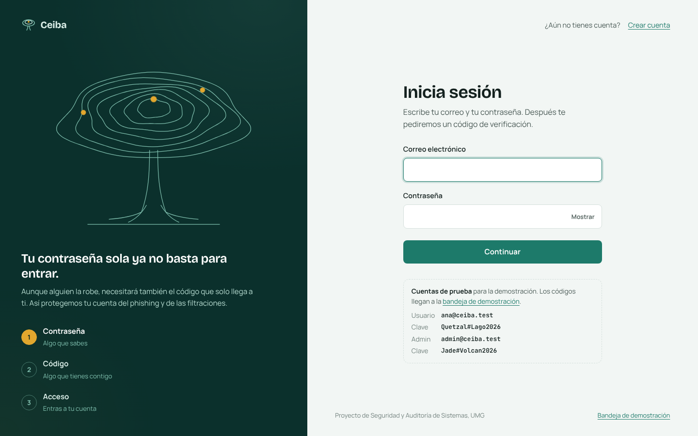

# Ceiba: autenticación multifactor para aplicaciones web

Proyecto del curso **Seguridad y Auditoría de Sistemas** (Universidad Mariano Gálvez de Guatemala).

Ceiba es una aplicación web de inicio de sesión que exige **dos factores**: algo que sabes (tu contraseña) y algo que tienes (tu teléfono o tu correo). Incluye tres métodos de segundo factor, códigos de respaldo, bloqueo ante fuerza bruta, bitácora de auditoría, panel de monitoreo y un conjunto automatizado de **15 pruebas de ataque**.



## Contenido del repositorio

| Ruta | Qué contiene |
|---|---|
| `COMO-PROBAR.txt` | Guía paso a paso para instalar y probar la aplicación |
| `iniciar.bat` | Inicio con doble clic en Windows |
| `docs/Informe-Proyecto-MFA.pdf` / `.docx` | Informe escrito del proyecto |
| `docs/capturas/` | Capturas de pantalla y diagramas |
| `reports/reporte-ataques.html` | Último reporte de las pruebas de ataque |
| `src/`, `views/`, `public/` | Código de la aplicación |
| `tests/ataques.js` | Pruebas automatizadas de ataque |

## Inicio rápido

```bash
git clone https://github.com/HLJDanni/2MFA---Auditor-a-y-Seguridad-de-Sistemas.git
cd 2MFA---Auditor-a-y-Seguridad-de-Sistemas
npm install
npm start
```

En Windows también puedes dar doble clic a `iniciar.bat`. Las instrucciones completas están en [`COMO-PROBAR.txt`](COMO-PROBAR.txt).

## Requisitos

- [Node.js](https://nodejs.org) 18.17 o superior (recomendado: 20 o 22 LTS).
- No necesitas instalar ningún motor de base de datos: se usa SQLite embebido (archivo `data/ceiba.db`, se crea solo).

## Puesta en marcha

```bash
npm install
npm start
```

Abre <http://localhost:3000>.

### Cuentas de demostración

| Rol | Correo | Contraseña | Segundo factor |
|---|---|---|---|
| Usuario | `ana@ceiba.test` | `Quetzal#Lago2026` | Correo y SMS |
| Administrador | `admin@ceiba.test` | `Jade#Volcan2026` | Correo |

Los códigos por correo y SMS aparecen en la **bandeja de demostración**: <http://localhost:3000/demo/bandeja> (ábrela en otra pestaña; se actualiza sola). También se imprimen en la terminal.

Para probar la **app de autenticación**, crea una cuenta nueva en `/registro`, elige "App de autenticación" y escanea el QR con Google Authenticator, Microsoft Authenticator o Authy.

Para empezar de cero: `npm run reset` y luego `npm start`.

## Pruebas de resistencia frente a ataques

```bash
npm run test:ataques
```

Levanta una instancia aislada (puerto y base temporales), ejecuta los ataques por HTTP y genera `reports/reporte-ataques.html`.

| ID | Ataque | Defensa |
|---|---|---|
| A1 | Fuerza bruta / diccionario sobre la contraseña | Bloqueo progresivo tras 5 fallos (15, 30, 60 min…) |
| A2 | Contraseña robada (phishing, filtración) | El segundo factor es obligatorio; sin él no hay sesión |
| A3 | Fuerza bruta del código de 6 dígitos | 5 intentos por sesión; luego se exige la contraseña otra vez |
| A4 | Reutilización de un código TOTP interceptado | Cada paso de 30 s se acepta una sola vez |
| A5 | Reutilización de un código de respaldo | Un solo uso, guardado como HMAC |
| A6 | Código de correo/SMS vencido | Vigencia de 5 minutos |
| A7 | Acceso directo a URLs protegidas | Middleware de autenticación en cada ruta |
| A8 | Escalada a administrador | Control de acceso por rol (403) |
| A9 | Inyección SQL | Consultas parametrizadas |
| A10 | CSRF | Token sincronizado por sesión en todo POST |
| A11 | Enumeración de usuarios | Mismo mensaje, mismo bloqueo y mismo tiempo (bcrypt ficticio) |
| A12 | Fijación de sesión | Regeneración del identificador al elevar privilegios |
| A13 | Robo de la base de datos | bcrypt (costo 12), AES-256-GCM, HMAC-SHA256 |
| A14 | Clickjacking, XSS, robo de cookie | CSP estricta, X-Frame-Options DENY, cookie HttpOnly + SameSite |
| A15 | Ataque masivo desde una IP | Límite de intentos fallidos por IP (HTTP 429) |

## Funcionalidades

**Segundo factor**
- App de autenticación TOTP (RFC 6238) con código QR; secreto de 160 bits cifrado con AES-256-GCM.
- Código por correo (SMTP con Nodemailer) y por SMS (API de Twilio). Sin credenciales, se simulan en la bandeja de demostración.
- 10 códigos de respaldo de un solo uso, descargables en `.txt`.
- Método principal y métodos de reserva; cambio de método durante el inicio de sesión.
- "Recordar este dispositivo" 30 días con token aleatorio guardado como hash y revocable.

**Contraseñas**
- Política: 10+ caracteres, mayúsculas, minúsculas, número y símbolo; rechaza contraseñas comunes y las que contienen tu nombre o correo.
- Verificación contra filtraciones públicas con *Have I Been Pwned* usando k-anonimato (solo se envían 5 caracteres del hash SHA-1).
- Medidor de fortaleza en vivo.

**Sesión y auditoría**
- Cierre por inactividad (30 min), cookies `HttpOnly` y `SameSite=Lax`, regeneración de sesión.
- Bitácora de cada evento de seguridad, visible para el usuario y para el administrador.
- Correos de alerta: nuevo inicio de sesión desde otra IP, bloqueo, contraseña robada detectada, cambios en métodos.
- Panel de monitoreo (rol administrador) con indicadores, gráfico por hora y desbloqueo de cuentas.

## Correo y SMS reales (opcional)

Copia `.env.example` como `.env` y completa:

- **Gmail**: `SMTP_HOST=smtp.gmail.com`, `SMTP_PORT=587`, `SMTP_USER=tu correo`, `SMTP_PASS=` una [contraseña de aplicación](https://myaccount.google.com/apppasswords).
- **Twilio**: `TWILIO_ACCOUNT_SID`, `TWILIO_AUTH_TOKEN` y `TWILIO_FROM` (número de Twilio). En cuentas de prueba solo llega a números verificados.

## Producción

- `DEMO_MODE=false` (desactiva usuarios de prueba y la bandeja).
- Define `SESSION_SECRET` y `ENCRYPTION_KEY` como variables de entorno.
- Sirve detrás de HTTPS y usa `SECURE_COOKIES=true`.
- Para varias instancias, cambia el almacén de sesiones en memoria por uno compartido (Redis, base de datos).

## Estructura

```
src/
  server.js              Configuración de Express, cabeceras de seguridad y rutas
  config.js              Parámetros y políticas (se leen de .env)
  db.js                  SQLite (sql.js) y esquema de tablas
  security/crypto.js     AES-256-GCM, HMAC, comparación en tiempo constante, códigos aleatorios
  security/password.js   Política, bcrypt y consulta a Have I Been Pwned
  services/mfa.js        TOTP, códigos por correo/SMS, respaldo y dispositivos de confianza
  services/users.js      Cuentas, bloqueo progresivo y puntaje de seguridad
  services/notifier.js   Envío de correo y SMS (o bandeja de demostración)
  services/audit.js      Bitácora de seguridad
  middleware/            CSRF, sesión, control de acceso y límites por IP
  routes/                auth (login, verificación, registro), enroll, account, admin, demo
views/                   Plantillas EJS
public/                  CSS, JavaScript y fuentes (sin dependencias externas)
tests/ataques.js         Pruebas automatizadas de ataque
```
